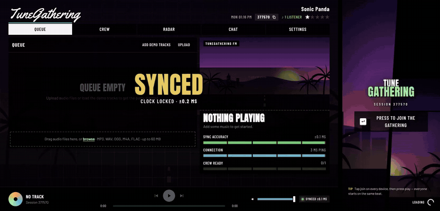
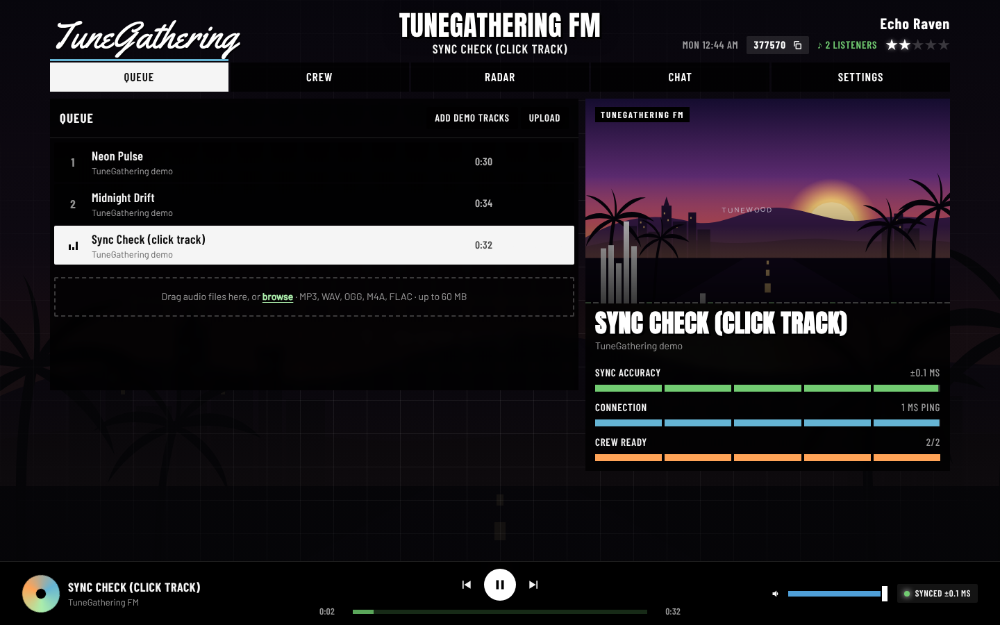
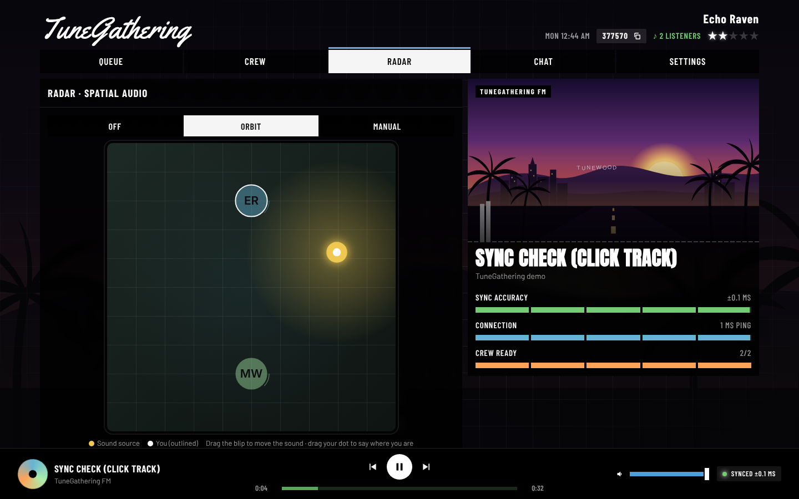
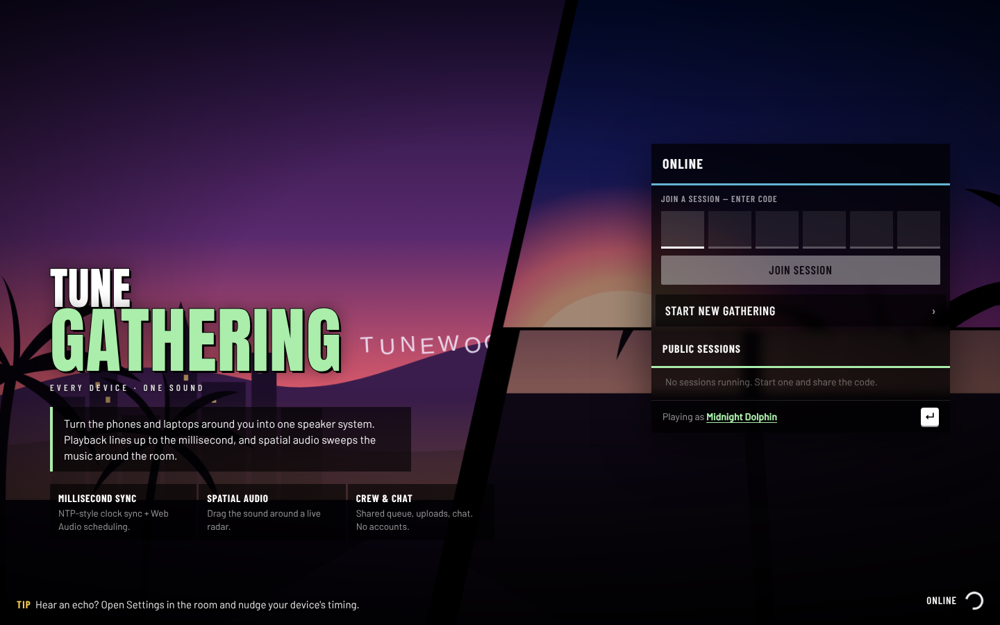
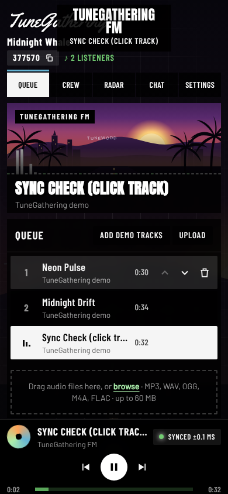
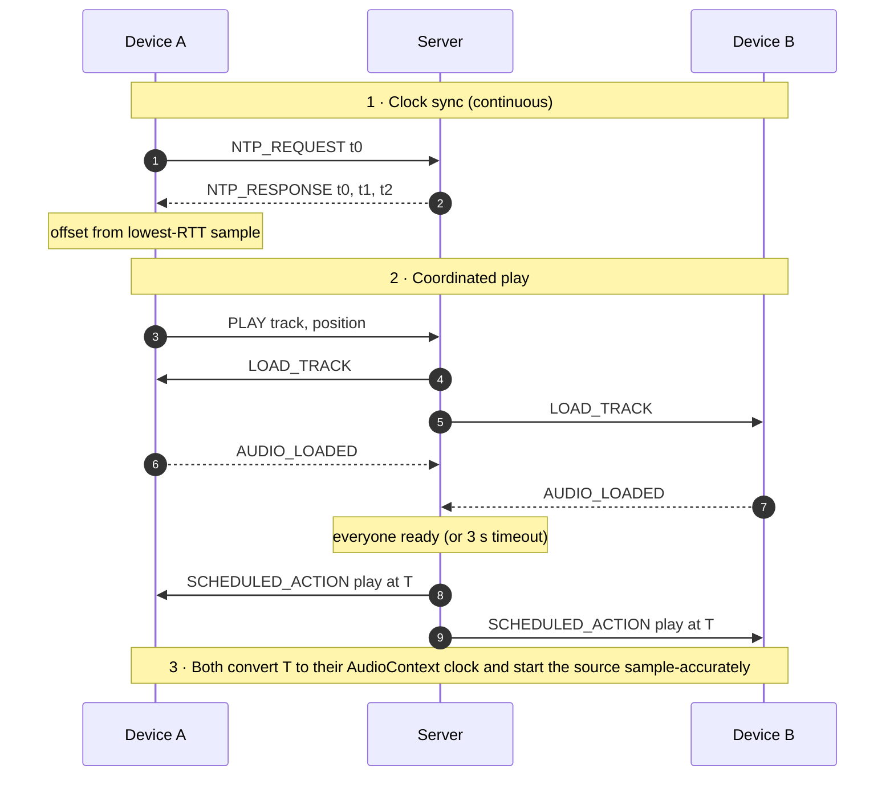

<div align="center">


# TuneGathering

**Every device. One sound.**

Turn the phones and laptops around you into a single speaker system.<br />
Playback is synced across devices to within milliseconds, right in the browser. No app, no account.

[](https://github.com/ww2d2vjh8c-lab/tunegathering/actions/workflows/ci.yml)
[](LICENSE)
[](https://nodejs.org)
[](CONTRIBUTING.md)
[](https://codespaces.new/ww2d2vjh8c-lab/tunegathering)

<a href="docs/media/demo.mp4"></a>

<sub>Laptop + phone in one room: join → synced → play → seek → radar → chat. <a href="docs/media/demo.mp4">Watch the full video (MP4)</a></sub>

</div>

---

## Why TuneGathering?

One phone speaker can't fill a room. Twenty phones can, but only if they play in step. With even 30 ms of drift you hear an echo, and past that it's a mess. TuneGathering keeps every browser on a shared clock and starts each track at the same instant on every device. That makes a pile of devices sound like one system.

- 🎯 **Millisecond sync.** An NTP-style clock protocol aligns every device. The Web Audio clock then starts each track sample-accurately, after correcting for the device's own output latency.
- 🌀 **Spatial audio.** Devices are dots on a radar. Drag a virtual sound source around the room, or let it orbit, and each device's volume follows its distance from the source.
- 🎛️ **Shared controls.** A queue everyone can see, plus seek, skip, room-wide volume and a low-pass "muffle" filter.
- 📤 **Bring your own music.** Drag in MP3, WAV, OGG, M4A or FLAC files. Three demo tracks are built in, including a click track for checking sync by ear.
- 💬 **Crew chat** with notifications. Plus **admins ("bosses")** who can lock the controls.
- 🎮 **A GTA V–inspired interface**, styled after the game's loading screens, pause menu and HUD. It works on phones and desktops alike.
- 🪶 **Tiny footprint.** One dependency (`ws`), no build step, no database. It runs anywhere Node 20+ does.

## Screenshots

| Pause-menu room | Spatial-audio radar |
| :---: | :---: |
|  |  |
| **Landing (loading screen)** | **Phone** |
|  |  |

## Quick start

```bash
git clone https://github.com/ww2d2vjh8c-lab/tunegathering.git
cd tunegathering
npm install
npm start
```

Open **http://localhost:3000** and press **Start new gathering**. The server also prints a `Network:` address. Open it on other devices on the same Wi-Fi, enter the 6-digit code, and tap **join** on each one.

<details>
<summary><b>Other ways to run it</b></summary>

**GitHub Codespaces.** Click the *Open in Codespaces* badge above. Dependencies install, the server starts, and the app opens in your browser. To let phones join, set port 3000 to **Public** in the *Ports* tab and share that URL.

**Docker**

```bash
docker build -t tunegathering .
docker run -p 3000:3000 tunegathering
```

**Development** (restarts on server changes)

```bash
npm run dev
```

</details>

> [!TIP]
> Browsers only allow audio after a tap, which is why every device has a "join" screen. For the tightest sync, use Chrome on devices that share a Wi-Fi network. Phones joining from other networks need HTTPS: put the server behind a reverse proxy or a tunnel such as `cloudflared`.

## Configuration

All configuration is through environment variables. The defaults work out of the box.

| Variable | Default | Description |
| --- | --- | --- |
| `PORT` | `3000` | HTTP + WebSocket port |
| `HOST` | `0.0.0.0` | Interface to bind (all interfaces, so LAN devices can connect) |
| `UPLOAD_DIR` | `./data/uploads` | Where uploaded tracks are stored (one folder per room) |

Upload size, room cleanup delay and other limits live in [`server/config.js`](server/config.js).

## How the sync works



1. **Shared clock.** Each device estimates its offset from the server clock. Queuing delay can only make a round trip longer, never shorter, so the sample with the lowest round-trip time is the most accurate.
2. **Load before scheduling.** No device starts until every device has the track decoded. The start time `T` sits far enough in the future to cover the slowest device's round trip.
3. **Speaker-accurate start.** `AudioContext.getOutputTimestamp()` maps the audio clock to the wall clock, including the device's output latency. Sound therefore leaves every speaker together, not just enters every audio buffer together. A device that's late skips ahead and stays in step instead of trailing behind.

In automated tests, two browser tabs start within **0.1 ms** of each other. Over real Wi-Fi the result depends on the network and the hardware; expect single-digit milliseconds. Bluetooth speakers add their own delay, so there's a per-device **timing nudge** in Settings.

The full protocol, message reference and design notes are in **[docs/ARCHITECTURE.md](docs/ARCHITECTURE.md)**.

## Project structure

```
server/            Node HTTP + WebSocket server (rooms, scheduling, uploads)
public/            Static frontend: HTML, CSS, vanilla ES modules, fonts, artwork
  js/sync.js       Clock synchronisation
  js/audio.js      Web Audio engine
  js/room.js       Room UI controller
scripts/           Demo-track synthesizer
test/              Integration tests (real WebSocket clients against a live server)
docs/              Architecture notes and media
```

## Roadmap

- [ ] Persist rooms across server restarts
- [ ] Streaming from music services and URLs
- [ ] Shareable QR code for joining
- [ ] Per-device delay auto-calibration using the microphone
- [ ] Installable PWA

Have an idea? [Open a feature request](https://github.com/ww2d2vjh8c-lab/tunegathering/issues/new/choose).

## Contributing

Contributions are welcome: bug reports, features, docs and design. Read **[CONTRIBUTING.md](CONTRIBUTING.md)** to get set up, and the **[Code of Conduct](CODE_OF_CONDUCT.md)** before you start. To report a security issue privately, follow **[SECURITY.md](SECURITY.md)**.

## Acknowledgements

- [**freeman-jiang/beatsync**](https://github.com/freeman-jiang/beatsync) (MIT): the excellent project behind beatsync.gg. Its NTP-style approach and load-then-schedule playback inspired TuneGathering's sync design. TuneGathering is an independent, simplified implementation.
- UI conventions were studied from FiveM community projects such as [project-error/pe-basicloading](https://github.com/project-error/pe-basicloading) and [F5-Studio-FiveM/GTA-VI-HUD-FIVEM](https://github.com/F5-Studio-FiveM/GTA-VI-HUD-FIVEM). No code or assets were copied.
- Fonts: [Anton, Barlow and Barlow Condensed](https://github.com/google/fonts) (SIL OFL 1.1) and [Yellowtail](https://github.com/google/fonts) (Apache 2.0).

> GTA and Grand Theft Auto are trademarks of Take-Two Interactive Software. TuneGathering is an independent fan-styled project. It is not affiliated with or endorsed by Rockstar Games or Take-Two, and it ships no game assets.

## License

[MIT](LICENSE) © Ayush Kaushik
