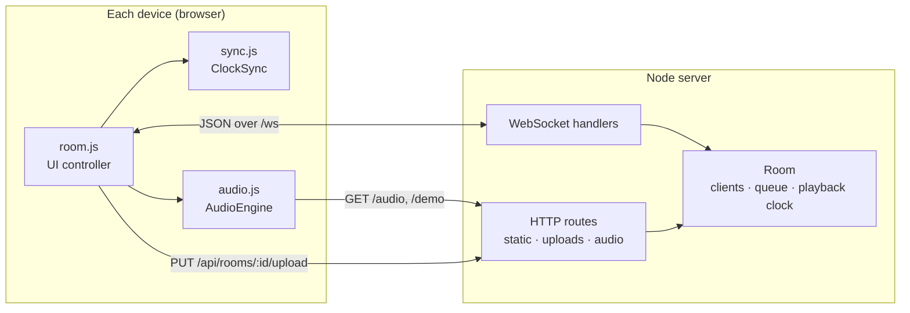

# Architecture

TuneGathering is a single Node process that serves a static frontend and runs one WebSocket per connected device. All state lives in memory.



## Server

| File | Responsibility |
| --- | --- |
| `server/index.js` | HTTP routing, static files (with Range support), uploads, the WebSocket message → handler table, heartbeat |
| `server/room.js` | `Room`: membership and admins, queue, the playback clock, load coordination, scheduling, spatial audio, chat, cleanup |
| `server/spatial.js` | Grid layout and the distance → gain curve |
| `server/time.js` | High-resolution `epochNow()` and the scheduling-delay heuristic |
| `server/config.js` | Limits and paths (overridable via `PORT`, `HOST`, `UPLOAD_DIR`) |

### The playback clock

A room stores playback as `{ trackId, isPlaying, trackTime, serverTime }`: *"track position `trackTime` happens at server time `serverTime`"*. From that, anyone can compute the position at any moment:

```
position(now) = isPlaying ? trackTime + (now − serverTime) / 1000 : trackTime
```

Play, pause, seek and late-join all reduce to writing or reading this one record.

### Load coordination

`PLAY` doesn't start anything immediately:

1. The server broadcasts `LOAD_TRACK` and records which clients it's waiting for.
2. Each client fetches and decodes the file, then replies `AUDIO_LOADED { trackId, duration }`.
3. When every client has replied, or after `audioLoadTimeoutMs` (3 s), the server broadcasts one `SCHEDULED_ACTION` with an absolute `serverTimeToExecute`.

The delay before `serverTimeToExecute` is `clamp(maxRTT × 1.5 + 250, 400, 3000)` ms. It's raised if any client reports a larger local compensation.

When a track ends, the server advances the queue by itself (using the duration clients reported).

### Lifecycle

- First person in a room becomes admin. If the last admin leaves, the longest-standing member is promoted.
- WebSocket protocol pings every 15 s. Browsers answer them even in throttled background tabs. Silent sockets are terminated.
- A reconnecting tab reuses its `clientId` (kept in `sessionStorage`), so it keeps its identity.
- A room is deleted, uploads included, 60 s after the last person leaves.

## Client

| File | Responsibility |
| --- | --- |
| `public/js/sync.js` | `ClockSync`: burst then steady NTP probes; offset from the min-RTT sample in a sliding window |
| `public/js/audio.js` | `AudioEngine`: decode cache (LRU), `playAt`/`stopAt`, gain/filter ramps, clock mapping |
| `public/js/room.js` | WebSocket client, state, rendering, controls, uploads, overlays |
| `public/js/spatial-grid.js` | Radar canvas with drag interactions |

### From server time to the speaker

```
ctxTime = engine.ctxTimeAtEpoch(serverTime − clockOffset − nudge)
```

`ctxTimeAtEpoch` uses `AudioContext.getOutputTimestamp()`. That call pairs the frame currently leaving the speaker with the performance clock, so the mapping already includes output latency. If it's unavailable, the client falls back to `currentTime` minus `outputLatency`. If `ctxTime` has already passed, the source starts now and skips forward by the amount it missed.

Signal chain: `source → lowpass → spatial gain → room volume → analyser → destination`.

## Message reference

All messages are JSON objects with a `type` field.

### Client → server

| Type | Payload | Who |
| --- | --- | --- |
| `NTP_REQUEST` | `t0`, `rtt?`, `compensationMs?` | anyone |
| `SYNC` | – (late joiner asks for the current play) | anyone |
| `AUDIO_LOADED` | `trackId`, `duration` | anyone |
| `PLAY` | `trackId`, `trackTimeSeconds` | controllers |
| `PAUSE` / `NEXT` / `PREVIOUS` | – | controllers |
| `SET_VOLUME` | `volume` (0–1) | controllers |
| `SET_LOW_PASS` | `freq` (20–20000) | controllers |
| `ADD_DEMO_TRACKS` | – | controllers |
| `DELETE_TRACK` | `trackId` | controllers |
| `MOVE_TRACK` | `trackId`, `direction` (±1) | controllers |
| `START_SPATIAL` / `STOP_SPATIAL` | – | controllers |
| `SET_SPATIAL_MODE` | `mode` (`orbit` \| `manual`) | controllers |
| `SET_LISTENING_SOURCE` | `x`, `y` (0–100) | controllers |
| `MOVE_CLIENT` | `clientId`, `x`, `y` | self, or controllers |
| `CHAT` | `text` | anyone |
| `SET_USERNAME` | `username` | anyone |
| `SET_PERMISSIONS` | `permissions` (`EVERYONE` \| `ADMIN_ONLY`) | admins |
| `SET_ADMIN` | `clientId`, `isAdmin` | admins |

"Controllers" means everyone when permissions are `EVERYONE`, otherwise admins only.

### Server → client

| Type | Payload |
| --- | --- |
| `WELCOME` | `clientId`, `serverTime`, `room` (full snapshot) |
| `NTP_RESPONSE` | `t0`, `t1`, `t2` |
| `ROOM_EVENT` | `event`: `CLIENTS` · `TRACKS` · `CHAT` · `PERMISSIONS` · `LOAD_TRACK` · `PLAYBACK_RESET` |
| `SCHEDULED_ACTION` | `serverTimeToExecute`, `action`: `PLAY` · `PAUSE` · `VOLUME` · `LOW_PASS` · `SPATIAL_CONFIG` · `SPATIAL_OFF` |

### HTTP

| Route | Purpose |
| --- | --- |
| `GET /` · `GET /room/:id` | Landing and room pages |
| `PUT /api/rooms/:id/upload` | Raw file body; headers `X-Filename` (URI-encoded) and `X-Client-Id` |
| `GET /audio/:room/:file` · `GET /demo/:file` | Audio with `Range` support |
| `GET /api/rooms` | Active public sessions |
| `GET /api/health` | Liveness + server time |

## Design decisions

- **No framework, no build step.** The frontend is plain ES modules served as-is. Contributors can open a file and change it with no toolchain.
- **In-memory state.** Rooms are short-lived parties, not records. Persistence is on the roadmap but deliberately not required.
- **Server-authoritative clock.** Clients never trust each other's clocks, only the server's. That keeps the model simple and makes it robust to any one device misbehaving.
